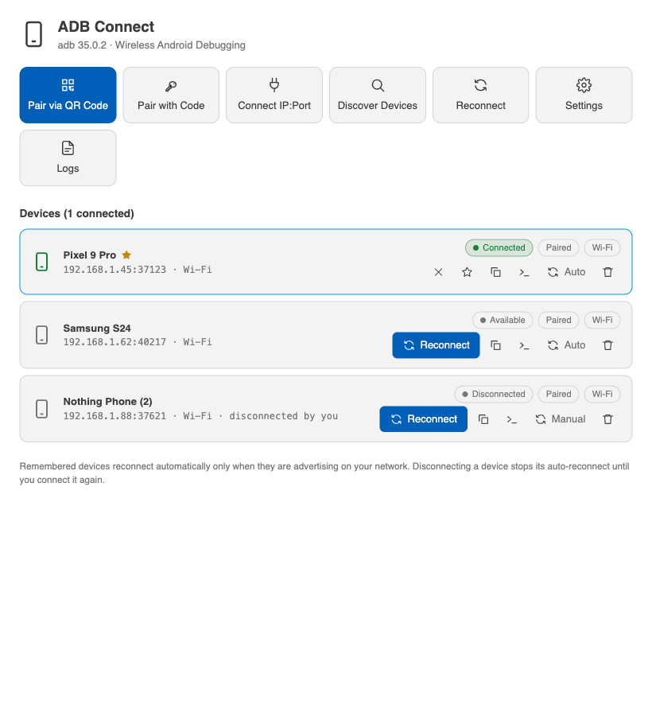
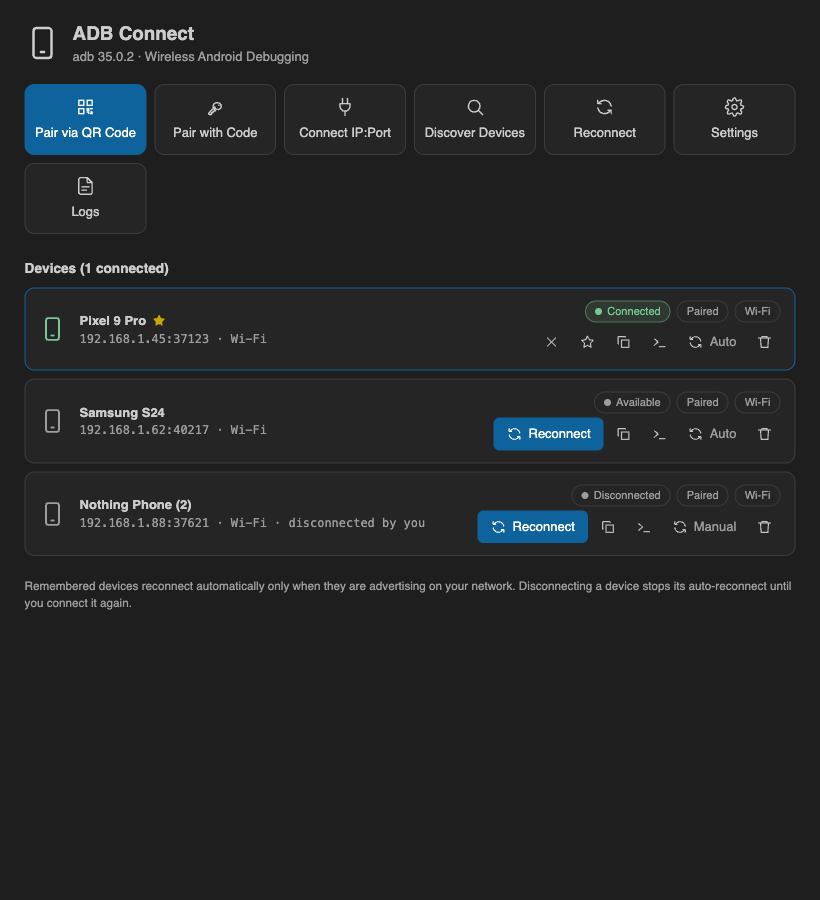
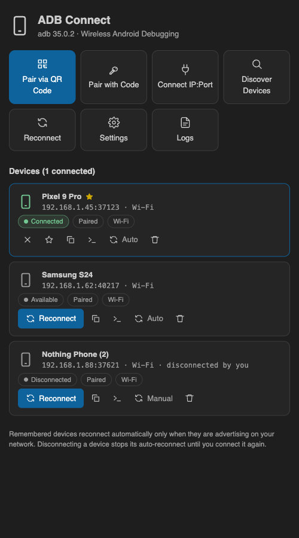
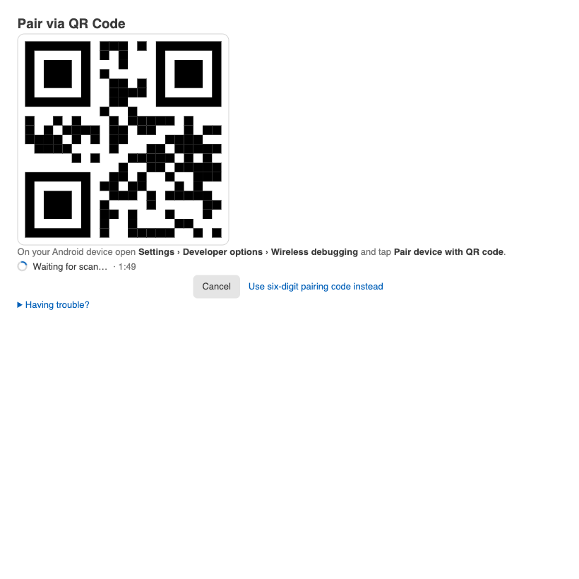
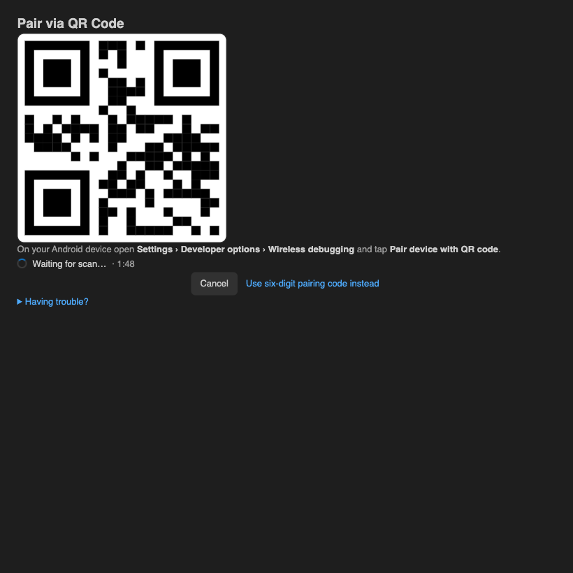

# ADB Connect — Wireless Android Debugging

Pair and connect Android devices over Wi-Fi in one click — real QR pairing, six-digit code
pairing, mDNS discovery, a device manager, and smart auto-reconnect — without running `adb`
by hand.

## Supported IDEs

ADB Connect is a VS Code extension and runs on VS Code and compatible VS Code-based hosts:

- Visual Studio Code (VS Code Marketplace)
- Kiro, Cursor, Windsurf, and other VS Code-based IDEs (Open VSX or VSIX)

This release ships a VS Code extension only; there is no JetBrains plugin in this version.

## Features

- **Real QR pairing** — a valid Android Wireless Debugging pairing QR (never a fake
  payload) with pairing state, result, Cancel/Retry, and help, plus a six-digit fallback.
- **Six-digit code pairing** and direct **IP:port connect**.
- **mDNS discovery** of devices advertising Wireless debugging, through the adb server.
- **Device Manager** with name, serial, IP:port, connection status, pairing status,
  transport type, and copyable adb commands.
- **Smart auto-reconnect** — remembered devices only, bounded retries, respects manual
  disconnects, never restarts the global adb server.
- **Multi-device** support with a preferred active device.
- **Status bar** with connection state and a quick-actions menu.

See [docs/FEATURES.md](./docs/FEATURES.md) for the full list.

## Screenshots

Device Manager, light and dark themes:

Narrow window layout:

QR pairing view:

## Quick start

1. Install adb (Android platform-tools; 31+ recommended) and ensure it is on your `PATH`
   or set `adbConnect.adbPath`.
2. Click the **ADB** status-bar item to open Quick Actions, then choose how to connect:
   - **Pair via QR Code** — scan from Developer options › Wireless debugging › Pair device
     with QR code (Android 11+).
   - **Pair via Pairing Code** — enter the host:port and six-digit code.
   - **Connect Device** — enter an `IP:port`.
3. Paired devices are remembered and reconnected automatically.

Full install steps (Marketplace, Open VSX, VSIX) are in
[docs/INSTALL.md](./docs/INSTALL.md).

## Settings

| Setting                        | Default | Description                                                                 |
| ------------------------------ | ------- | --------------------------------------------------------------------------- |
| `adbConnect.adbPath`           | `""`   | Path to `adb`; empty auto-detects via `ANDROID_HOME`/`ANDROID_SDK_ROOT`/`PATH`/default SDK. |
| `adbConnect.autoDiscover`      | `true`  | Continuously discover devices advertising Wireless debugging (mDNS).         |
| `adbConnect.autoReconnect`     | `true`  | Auto-reconnect remembered devices; never unknown devices or ones you disconnected. |
| `adbConnect.reconnectOnStartup`| `true`  | Reconnect remembered devices when the IDE starts (requires auto-reconnect).  |
| `adbConnect.showStatusBar`     | `true`  | Show the ADB Connect status-bar item.                                        |
| `adbConnect.preferredDevice`   | `""`   | Device shown in the status bar when several are connected.                   |
| `adbConnect.debugLogging`      | `false` | Log every adb invocation (secrets redacted).                                 |

## Troubleshooting

Common issues (adb not found, blocked Local Network/firewall/VPN, QR pairing, offline
devices) are covered in [docs/TROUBLESHOOTING.md](./docs/TROUBLESHOOTING.md). Use **View
Logs** from the quick actions for details.

## Privacy

- **No telemetry.**
- No pairing without an explicit user action.
- Pairing secrets are never logged or persisted; adb stores pairing keys in `~/.android`.
- The webview uses a strict CSP with a per-render nonce and no inline handlers.

## Validation

Manual validation scenarios and their status (including QR scenarios marked NOT VERIFIED
without a physical device) are in [docs/VALIDATION.md](./docs/VALIDATION.md).

## Develop

From the repo root: `npm install && npm run build`, then open the repo and launch an
Extension Development Host with `extensions/vscode` as the extension path. The extension is
bundled with esbuild (`@adb-connect/core` and `qrcode` are inlined). Package a VSIX with
`npm run -w extensions/vscode package` (output: `dist/adb-connect-vscode-0.2.0.vsix` at the
repo root).

## License

[MIT](./LICENSE). Publisher id `guitar-dev-io` and repository URLs are placeholders.
